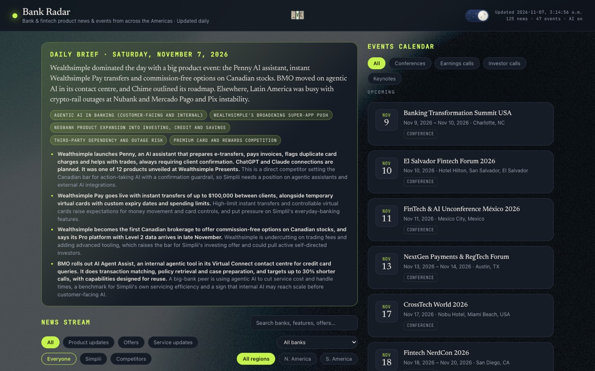

# Bank Radar

**Live: [bank-radar.raykhan.me](https://bank-radar.raykhan.me)**

A dashboard for the Simplii Financial product team that tracks:

1. **News stream:** product, offer and service news from banks and fintechs across the Americas.
   Filter by type, bank, region, or Simplii vs competitors, and search.
2. **Events calendar:** recent and upcoming conferences, keynotes, earnings calls and investor calls,
   with filter chips by type.
3. **Daily brief:** an AI summary of the common themes and the news worth reacting to.

Portuguese and Spanish articles from Latin America are translated to English. Data refreshes
daily at **4:30am Eastern**.



## How it works

```
RSS feeds ──────► classify ──┐
                             ├─► merge + dedupe ─► translate ─► brief ─► data/*.json ─► static site
web search ──► discover ─────┘
                       (all in scripts/aggregate.mjs)
```

- **RSS** pulls every headline from the feeds in `feeds.json`. It's the "don't miss anything" layer.
- **Classify** (Claude Haiku) tags each item `product` / `offer` / `service`, sets the bank and region,
  and drops noise, including banks based outside the Americas.
- **Discover** (Claude Sonnet with web search) finds offers and events that have no RSS feed.
- **Merge + dedupe** combines today's items with the existing board. The same story is merged when
  it arrives from several sources with the same title, or as reworded copies of one article (same
  link, overlapping headline). Different stories from one roundup article stay separate. Items older
  than `maxAgeDays` drop off.
- **Translate** (Claude Haiku) tags each item's language once. Non-English titles and summaries
  become English, keeping bank and product names (Pix, Nu Smart Invest…). The original headline is
  kept for search and shown on hover over the card's "Translated from …" label.
- **Brief** (Claude Sonnet) writes the daily summary from the final board.

Output is plain JSON committed to the repo. The front end is static: **no backend, no database.**
Without `ANTHROPIC_API_KEY` the script still runs, but produces no board items, since raw feed
headlines are too noisy to show unclassified.

| File | Contents |
|---|---|
| `data/news.json` | Board items: `title`, `summary`, `url`, `source`, `bank`, `category`, `region`, `date`, `lang`; translated items also have `titleOriginal` |
| `data/events.json` | Events: `name`, `type`, `organizer`, `location`, `region`, `date`, `endDate`, `url` |
| `data/summary.json` | The daily brief: `tldr`, `themes`, `highlights` |
| `data/meta.json` | Last update time and counts |

## Daily refresh

`.github/workflows/refresh.yml` runs the pipeline, commits the new data, and that commit redeploys
the site.

- **When:** 4:30am Eastern, year-round. GitHub's schedule is UTC-only with no daylight saving, so the
  workflow is scheduled at both 08:30 and 09:30 UTC. A small `when` job keeps whichever one is 4:30am
  in New York that day, so you'll see one short **skipped** run per day, which is expected. GitHub can
  start scheduled runs several minutes late.
- **On demand:** Actions → **Refresh dashboard data** → **Run workflow**, or `gh workflow run refresh.yml`.
- **Setup:** add `ANTHROPIC_API_KEY` under repo Settings → Secrets and variables → Actions.

## Run locally

```bash
npm install
npm run selftest                            # merge/dedupe/translation logic
npm run dev                                 # serve at http://localhost:3000
ANTHROPIC_API_KEY=sk-... npm run refresh    # pull live data into data/
```

## Deploy

Static files from the repo root, no build step. The live site is served by Cloudflare and redeploys
on every push to `main` (about 30 seconds). Any static host works.

- **Search engines are kept out:** `_headers` sends `X-Robots-Tag: noindex, nofollow`, and
  `robots.txt` blocks crawlers.
- **Link previews still work:** `robots.txt` allows the preview bots (X, LinkedIn, Facebook, Slack,
  Discord) so shared links unfurl with the preview image.

## Link preview image

`og-image.jpg` (1200×630) is rendered from `docs/og-image.html`. After editing that page, re-render
it with the command in its header comment. To refresh LinkedIn's cached preview, use
[Post Inspector](https://www.linkedin.com/post-inspector/).

## Tuning

**`feeds.json`** (no code):
- `feeds`: RSS sources (bank newsrooms, fintech press, Google News searches).
- `banks`: the watchlist that steers classification and discovery.
- `topics`, `regions`, `maxAgeDays` (default 120), `maxNewsItems` (default 150).

**`scripts/aggregate.mjs`**: `MODEL_FAST` (classify + translate) and `MODEL_SMART` (discovery + brief)
set which Claude models are used.

## Front-end notes

- Light/dark theme toggle, with the choice saved per browser.
- A radar loading screen shows until the data has rendered. It stays still if the visitor has
  reduced motion turned on.
- The header money emoji plays a "ching" and bursts emoji confetti on click. It's hidden on windows
  narrower than 1100px, where it would collide with the subtitle.
